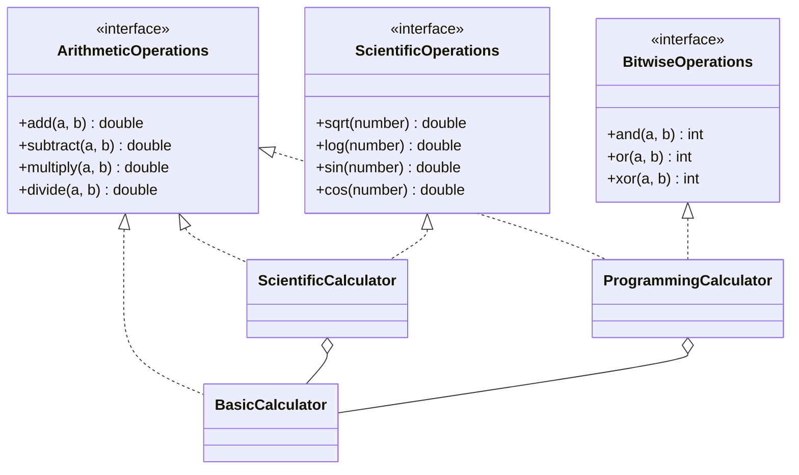

# SOLID – ISP In-Class Exercise

Hesap makinesi projesinin interface yapısı, Interface Segregation Principle (ISP) dikkate alınarak yeniden düzenlenmiştir.

## Çalıştırma

Projeyi IntelliJ IDEA ile açıp `src/com/example/gitdemo/Calculate/CalculatorMain.java` dosyasını çalıştırın.

Komut satırından:

```bash
javac -d out src/com/example/gitdemo/Calculate/*.java
java -cp out com.example.gitdemo.Calculate.CalculatorMain
```

Beklenen çıktı:

```
=== BASIC CALCULATOR ===
10 + 5 = 15.0
10 - 5 = 5.0

=== SCIENTIFIC CALCULATOR ===
√25 = 5.0
log(100) = 2.0

=== PROGRAMMING CALCULATOR ===
5 AND 3 = 1
5 OR 3 = 7
5 XOR 3 = 6
```

## Mevcut Tasarımdaki Problem

Başlangıç kodunda tüm işlemler tek bir `Calculator` interface'inde toplanmıştı (11 metot). Üç sınıf da bu interface'i implemente ettiği için kullanmadıkları metotları da yazmak zorunda kalıyordu:

| Sınıf | Gerçekten kullandığı | Zorla implemente ettiği (`UnsupportedOperationException`) |
|---|---|---|
| `BasicCalculator` | add, subtract, multiply, divide | sqrt, log, sin, cos, and, or, xor (7) |
| `ScientificCalculator` | aritmetik + sqrt, log, sin, cos | and, or, xor (3) |
| `ProgrammingCalculator` | aritmetik + and, or, xor | sqrt, log, sin, cos (4) |

Bu yapının sonuçları:

- **ISP ihlali:** Sınıflar kullanmadıkları metotlara bağımlı. Toplam 14 metot sadece exception fırlatmak için vardı.
- **Hata derleme zamanında yakalanmıyor:** `Calculator c = new BasicCalculator(); c.sin(1);` derlenir ama çalışma zamanında patlar. Interface "bu nesne sin hesaplar" sözü veriyor ama nesne bu sözü tutmuyor. Bu durum aynı zamanda Liskov Substitution Principle'a da aykırı.
- **Gereksiz değişiklik etkisi:** Interface'e örneğin `tan` eklenirse, bilimsel işlemle hiçbir ilgisi olmayan `BasicCalculator` ve `ProgrammingCalculator` da değiştirilmek zorunda kalır.

## Yeni Tasarım

Tek büyük interface, işlem gruplarına göre üç küçük interface'e bölündü:

```
ArithmeticOperations   add, subtract, multiply, divide
ScientificOperations   sqrt, log, sin, cos
BitwiseOperations      and, or, xor
```

Her sınıf yalnızca gerçekten desteklediği işlemlerin interface'lerini implemente ediyor:

```
BasicCalculator        implements ArithmeticOperations
ScientificCalculator   implements ArithmeticOperations, ScientificOperations
ProgrammingCalculator  implements ArithmeticOperations, BitwiseOperations
```



## Tasarım Kararlarının Gerekçesi

1. **Interface'ler kullanıcıya göre ayrıldı.** Ayrım noktası, işlemlerin hangi hesap makinesinde birlikte kullanıldığına göre belirlendi. Aritmetik işlemler üç makinede de ortak olduğu için tek bir interface'te kaldı. Bilimsel ve bitwise işlemler ise birbirinden bağımsız olduğu için ayrı interface'lere alındı.
2. **`UnsupportedOperationException` tamamen kaldırıldı.** Bir sınıfın desteklemediği bir işlem artık o sınıfın tipinde yer almıyor. `basic.sin(1)` gibi bir çağrı çalışma zamanında hata vermek yerine artık derlenmiyor.
3. **Eski `Calculator` interface'i silindi.** Tüm metotları tek çatı altında toplayan bir interface bırakmak, problemi geri getirmek anlamına gelir.
4. **Aritmetik kod tekrarı composition ile giderildi.** `ScientificCalculator` ve `ProgrammingCalculator`, aritmetik işlemleri içlerindeki bir `BasicCalculator` nesnesine devrediyor. `extends BasicCalculator` yerine bu yolun seçilmesinin nedeni, bu sınıfların "bir tür BasicCalculator" olması gerekmemesi ve kalıtımla gelen sıkı bağımlılıktan kaçınılması.
5. **Davranış korundu.** `CalculatorMain` hiç değiştirilmedi. Programın çıktısı refactor öncesiyle birebir aynı. `ProgrammingCalculator`'ın aritmetik işlemleri de eskisi gibi `double` ile çalışmaya devam ediyor.

## Kazanımlar

- Yeni bir işlem grubu (ör. istatistik işlemleri) yeni bir interface ile eklenebilir. Mevcut sınıflara dokunmak gerekmez.
- Bir istemci sadece ihtiyaç duyduğu yeteneğe bağımlı olabilir. Örneğin yalnızca bitwise işlem yapan bir kod `BitwiseOperations` tipini kullanır.
- Sınıfların yapabildikleri, tiplerinden doğrudan okunabiliyor.
